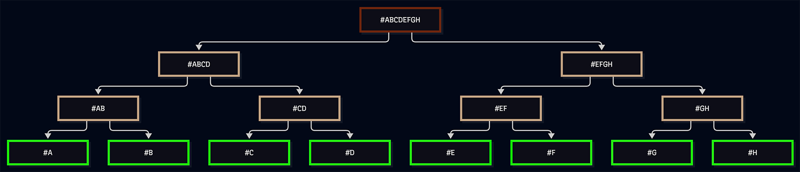

# 19.1: Understanding MAST

MAST stands for Merkelized Abstract Syntax Tree, an idea first
suggested in 2016 as [BIP
114](https://github.com/bitcoin/bips/blob/master/bip-0114.mediawiki). Though
that BIP has been closed, the idea lives on in the Taproot Update.

(The term MAST is not used in BIP-341, but is referenced here for its
historic usage.)

## Understand the Merkle Tree

A Merkle Tree is also known as a hash tree. That's because it's a tree
of hashes. Data is hashed to form the leaves at the bottom level of
the tree. Then hashes are combined to form a node. Usually a Merkle
tree is a binary hash tree, which means that every pair of hashes are
combined.

> 📖 **_What is a hash?_** A hash is the output of a hash
function. It's a short, fixed-length representation of a longer
variable-length input. Hash functions are designed to be collision
resistant, which means that each hash uniquely represents one input,
and also to be trapdoor functions, which means that you can derive a
hash from the input, but you can't derive the input from the hash.

As you ascend in a hash tree, more hashes are combined, resulting in
fewer and fewer nodes. Ultimately, you get a root hash that represents
all of the individual hashes of the tree, and so all of the individual
data input into the tree. A hash tree is usually represented just by
its root hash.

  

Individual leaves of a hash tree can be revealed without revealing the
content as a whole: a user simply reveals the leaf and then a path of
each of the hashes that it contributes to, up to the root hash.

## Understand the MAST

MAST is a simple application of the Merkle Tree to Bitcoin Scripts:
each leaf represents a Bitcoin Script (or rather, the slightly varied
Tapscript) that can be used to unlock the funds at a Taproot
address. That Merkle Tree is then brought into a Bitcoin address using
Taproot.

* If there is **no Script**, then the Taproot address is tweaked with
an unspendable script path.
* If there is a **Merkle Tree**, then the Taproot address is tweaked
with the root hash of the tree.

To spend from a Taproot address using a key just requires a signature
from the private key and the inclusion of the public key (just like
with traditional P2PKH and P2WPKH addresses).

To spend from a script in the Merkle Tree requires that the spender
supply the script and the inputs that satisfy the script (just as with
traditional P2SH and P2WSH addresses), but also the path in the Merkle
Tree that runs from the leaf script being satisfied to the root hash
that was encoded in the P2TR address. This proves that the script is
in the Merkle Tree represented by the root-hash tweak.

## Summary: Understanding MAST

MASTS, built with Merkle Trees, are included in Taproot. They're a way
to simply and efficiently support a whole collection of scripts, any
of which can unlock an address, and which can be used as alternatives
to typical key path spending.

> 🔥 ***What is the power of MAST?*** MAST is a way to record a whole
collection of scripts as a single root hash that Taproot then applies
as a tweak to a Taproot address. This methodology ensures that no one
knows what the scripts or, or even that there are scripts, before
they're actually used. So besides the versatility implicit in being
able to unlock funds in a variety of ways, you also get privacy.

## What's Next?

Continue "Using Tapscript" with [§19.2: Designing
Tapscripts](19_2_Designing_Tapscripts.md).

